# Как сохранить свой ЖЖ

«Архив ЖЖ» сохраняет записи и ветки комментариев на вашем компьютере. Их можно читать без интернета, искать по словам и открывать по датам. Ниже показан путь от скачивания приложения до первой копии своего журнала или сообщества.

[Скачать для Windows, macOS и Linux](https://staerum.ru/journal-archive/) · [GitHub Releases](https://github.com/vladfedin/journal-archive/releases/latest) · [PDF](guide.pdf) · [Веб-версия](https://staerum.ru/journal-archive/guide/)

Windows x64 · версия **0.9.6** · на скриншотах вымышленный журнал.

[Скачать](#1-скачать) · [Создать архив](#4-войти-и-выбрать-что-сохранить) · [Читать и искать](#6-открыть-результат) · [Отчёт](#7-проверить-отчёт) · [Статистика](#8-посмотреть-статистику) · [Обновить](#сохранить-копию-и-обновлять-архив)

## 1. Скачать

На [странице загрузки](https://staerum.ru/journal-archive/) выберите **Windows x64** в верхнем выпуске. Для версии 0.9.6 файл называется `JournalArchive-0.9.6-windows-x64.exe` и занимает около 105 МиБ. На той же странице есть пакеты для Mac с процессором Apple или Intel и для Linux x64.

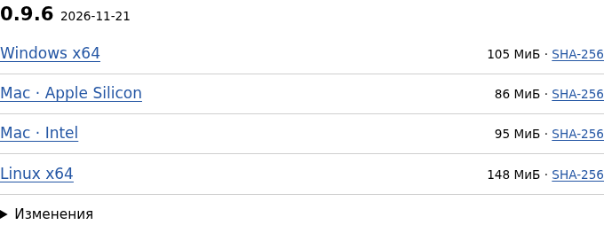

## 2. Разрешить первый запуск

Откройте EXE. Сборка 0.9.6 распространяется без подписи издателя. Если SmartScreen покажет «Система Windows защитила ваш компьютер», нажмите **Подробнее**. Сверьте имя файла и убедитесь, что скачали его со страницы проекта. Для запуска нажмите **Выполнить в любом случае**.

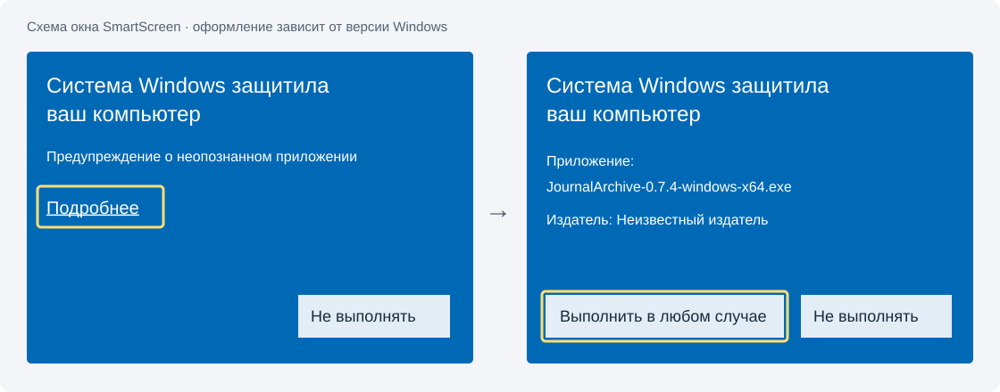

Если предупреждения нет, переходите к следующему шагу. На управляемом компьютере запуск может быть ограничен администратором. [Справка Microsoft о SmartScreen](https://learn.microsoft.com/en-us/windows/apps/package-and-deploy/smartscreen-reputation)

## 3. Запустить приложение

EXE запускается без установки. Дождитесь страницы **Архивы** в браузере и нажмите **Новый архив**. Адрес обычно начинается с `http://127.0.0.1:8787/`. Эту страницу обслуживает приложение на вашем компьютере.

Внизу страницы указан каталог, где будут храниться данные. Чтобы выбрать другой диск для всех архивов, нажмите **Переместить** между загрузками.

## 4. Войти и выбрать, что сохранить

Введите логин ЖЖ без адреса сайта и пароль. Для личного архива оставьте **Мой журнал**. Выберите **Весь журнал**, **За период** или **Тест (последние 10 записей)**. Период задаёт даты публикации записей. Комментарии к этим записям собираются за всё время.

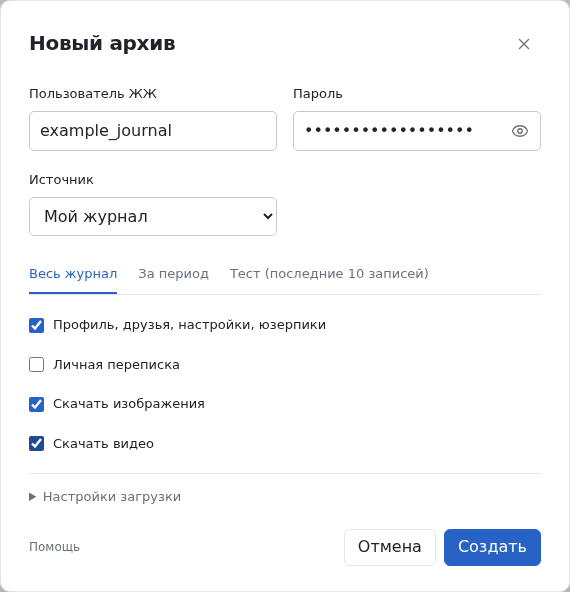

Для сообщества войдите под своим логином, выберите **Моё сообщество** и нажмите **Показать сообщества**. Выберите нужное из списка сообществ, которыми вы управляете. В следующий раз список откроется из сохранённой копии. Его можно обновить, если состав изменился.

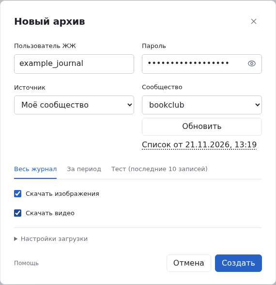

Отметьте нужные материалы. Изображения и видео включаются отдельно. Для личного журнала можно также выбрать профиль с друзьями и настройками и личную переписку. Нажмите **Создать**. Для пробы на десяти записях в настройках установлен лимит 50 запросов, его можно изменить.

## 5. Дождаться загрузки

Архив сначала сохраняет записи и комментарии, затем скачивает изображения и видео. При выгрузке без лимита запросов приложение проверяет закреплённую запись сразу после входа. Если сервер материалов просит подождать, загрузка может продолжиться с другого сервера.

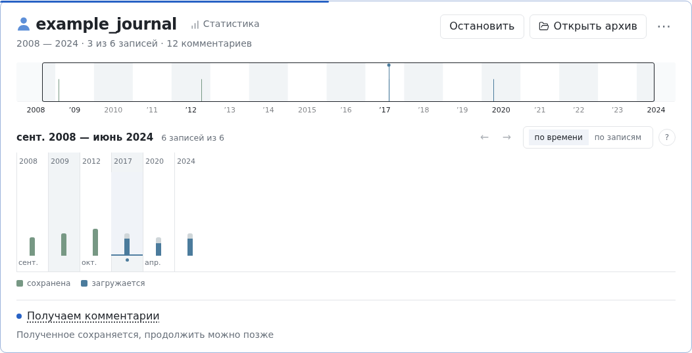

Нажмите на строку **Получаем комментарии** или другой текущий статус, чтобы открыть журнал операции. Там видны адрес запроса, ответ, время ожидания и повторные попытки. Каждый столбик хронологии ведёт к записи, когда её страница уже доступна.

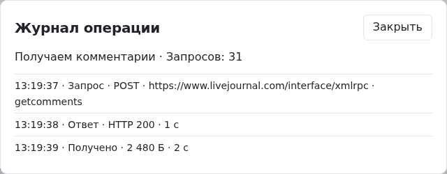

Можно остановить работу и продолжить позже с карточки архива. Уже полученное останется на диске. Закрытие вкладки оставляет приложение работающим. Для выхода нажмите **Завершить приложение** внизу библиотеки.

## 6. Открыть результат

На карточке журнала нажмите **Открыть архив**.

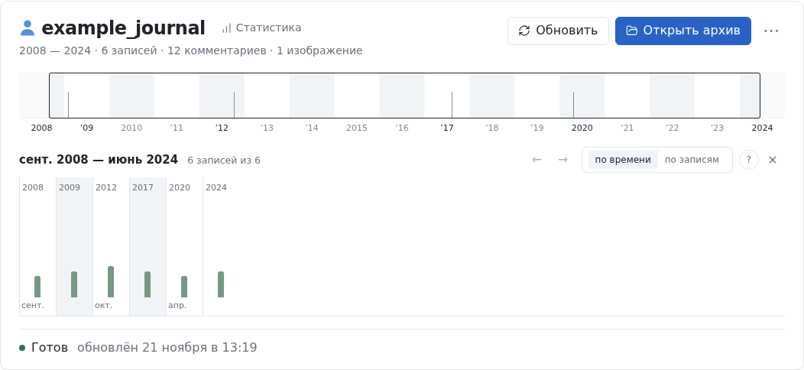

В **Записях** переключайтесь между краткой и полной лентой. Следующие записи появляются при прокрутке. Подтверждённый закреп виден вверху общей ленты. В **Календаре** выберите год, месяц или день.

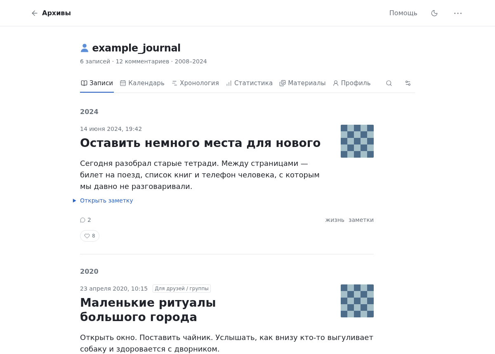

Нажмите лупу над лентой, затем **Расширенный поиск**. Введите слова или точную фразу в кавычках. Результаты можно ограничить комментариями, автором или годом. Нажмите на фрагмент, чтобы открыть его в контексте.

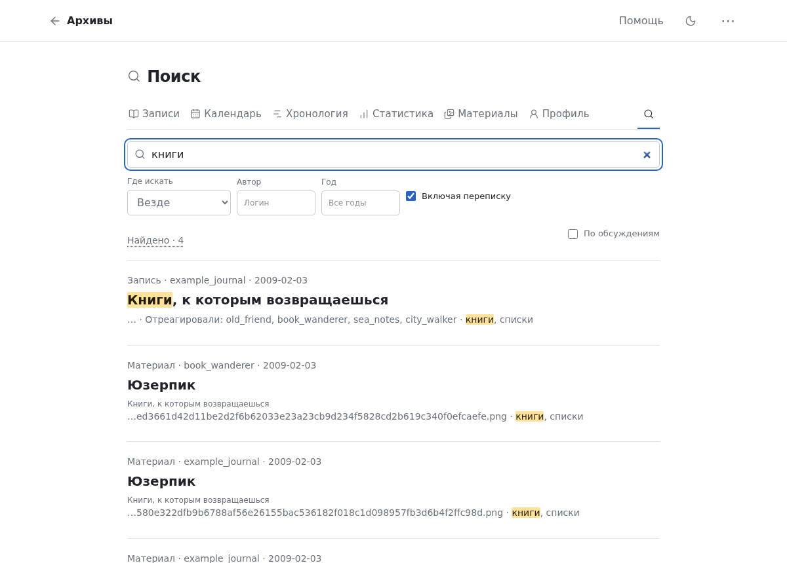

Откройте запись, чтобы прочитать ветку ответов. В полном тексте раскрывается lj-cut. В **Материалах** изображения и видео ведут к записям и комментариям, где они встречаются. Юзерпики вынесены в отдельную вкладку. В **Профиле** доступны сохранённые сведения об авторе и его связях.

## 7. Проверить отчёт

Откройте **⋯ → Состояние архива** на карточке журнала. В отчёте указано, сколько записей, комментариев и файлов сохранено. Разверните **Подробности проверки**, чтобы увидеть причины пропусков и ссылки на затронутые записи и материалы.

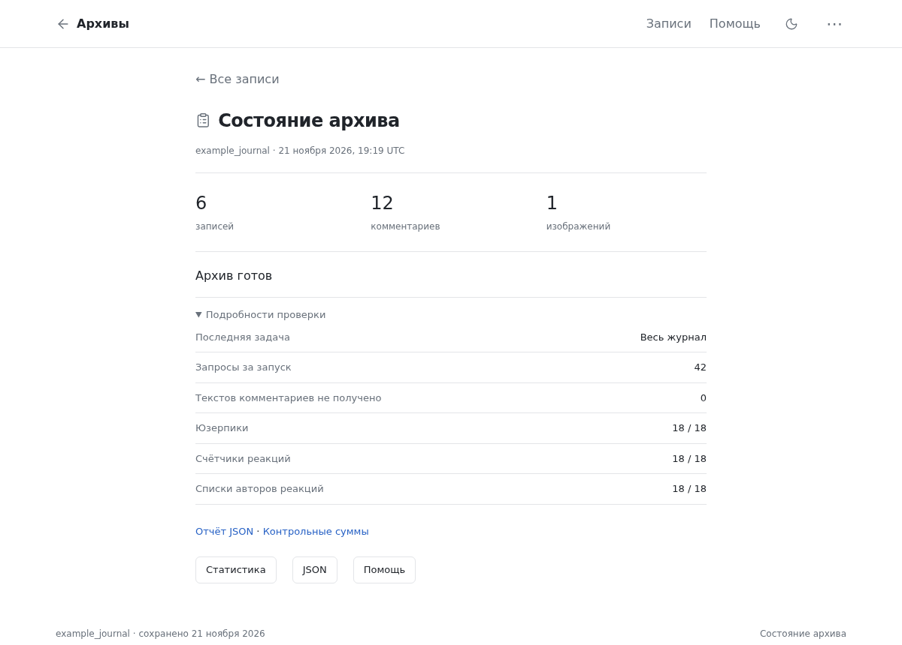

Если остались доступные для повтора материалы, вернитесь в библиотеку и нажмите **Докачать** или **Докачать пропуски** на карточке журнала. Отдельный файл можно запросить со страницы записи. Для закрытых изображений доступна загрузка через браузер с вашим входом в ЖЖ. Если оригинал больше недоступен, в архиве останется ссылка на него.

## 8. Посмотреть статистику

Нажмите **Статистика** рядом с названием журнала. Верхние строки показывают записи по году публикации и комментарии по году ответа. Ниже видно, кто и когда участвовал в обсуждениях. Флажок **С автором журнала** включает владельца в таблицу участников.

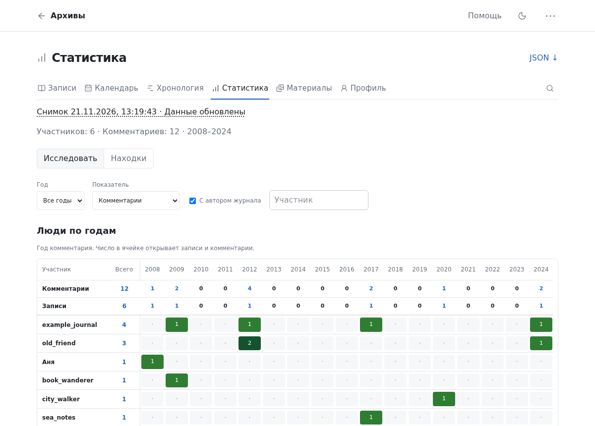

Нажмите на число в таблице, чтобы открыть соответствующие записи и комментарии с датами. Во вкладке **Находки** можно увидеть, к каким обсуждениям возвращались спустя годы. Для незавершённого архива статистика отражает уже сохранённые данные.

## Сохранить копию и обновлять архив

В меню **⋯** выберите **ZIP-архив**, чтобы получить страницы, доступные медиа и данные. Распакуйте ZIP и откройте `index.html`. Для работы с данными отдельно доступны **JSON (ActivityStreams)** и **Исходный JSON**. В ZIP и в оба JSON попадают закрытые записи, доступные вам скрытые комментарии и личная переписка, если вы её скачали. Учитывайте это перед передачей архива.

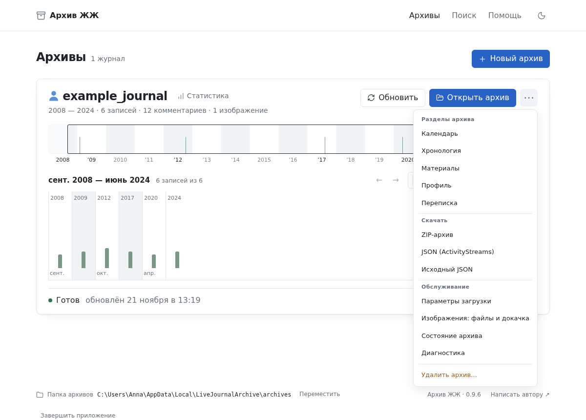

Чтобы добавить новые записи, нажмите **Обновить** и укажите период. Для старой записи, в которой продолжилось обсуждение, выберите **По ссылкам** и вставьте адрес записи или комментария. Для полной сверки выберите весь журнал. Кнопка **Переместить** внизу библиотеки переносит всю рабочую папку со всеми архивами. После переноса загрузку можно продолжить.

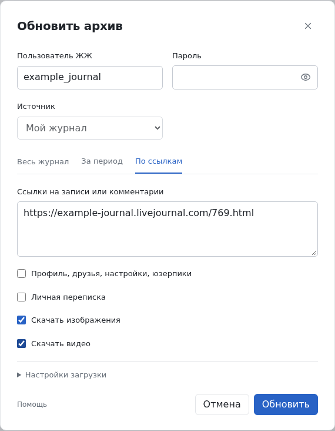

[Скачать приложение](https://staerum.ru/journal-archive/) · [Изменения в 0.9.6](https://github.com/vladfedin/journal-archive/releases/tag/v0.9.6) · [Исходники и документация](../../README.md)
