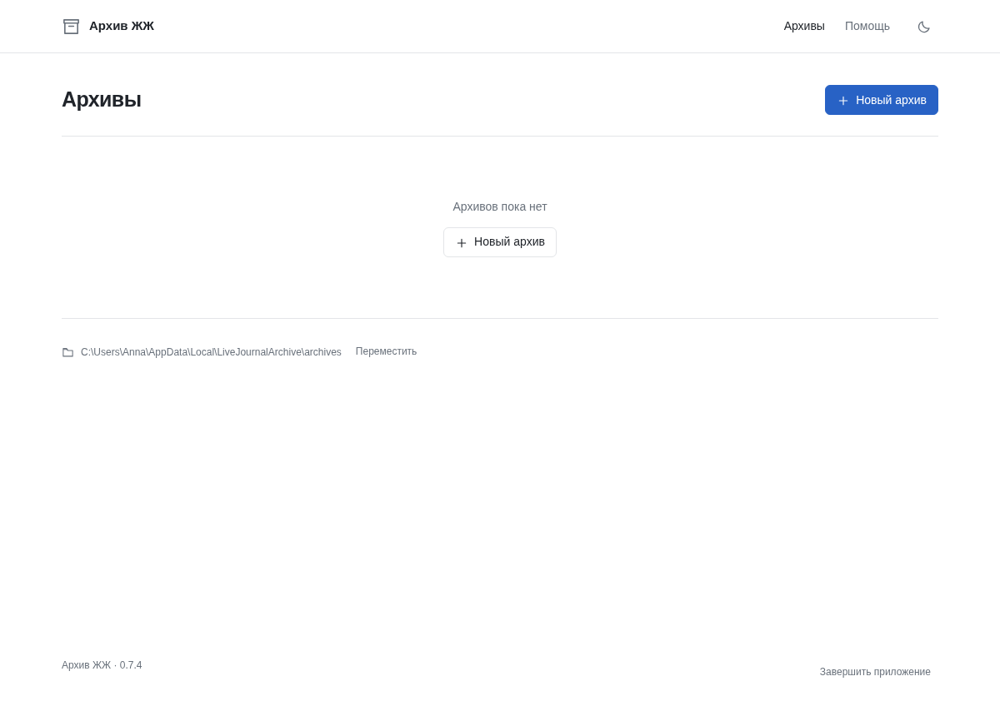
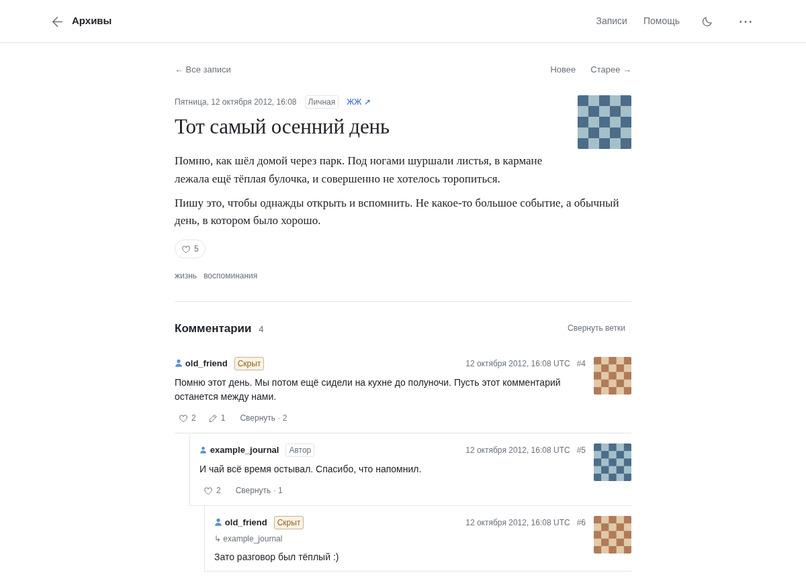
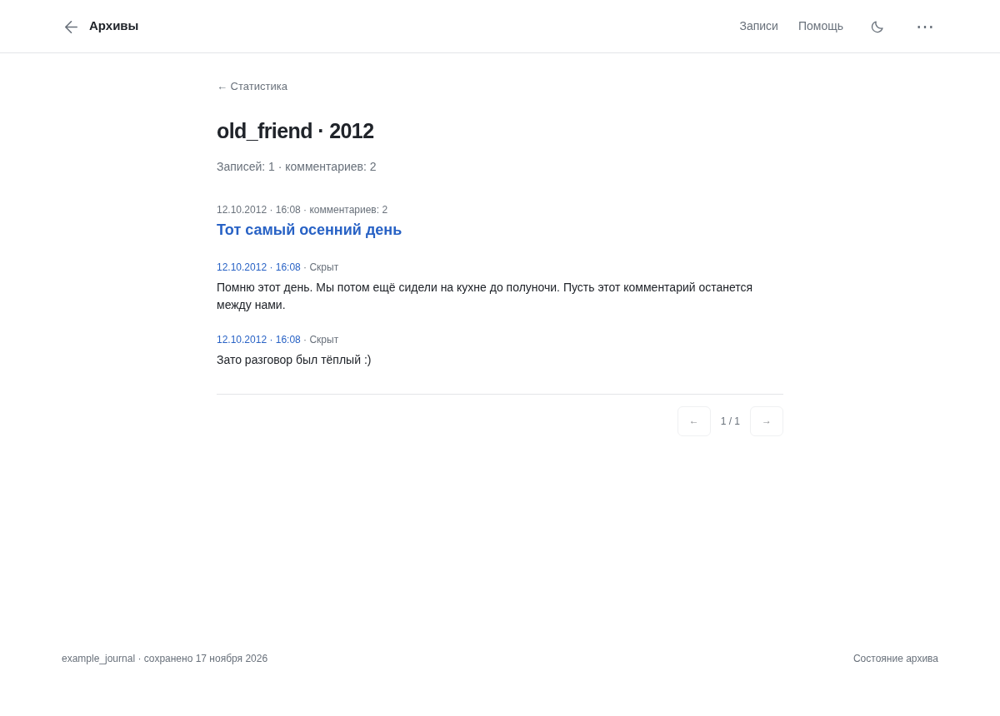

# Как сохранить свой ЖЖ

Пошаговый гайд для Windows 10/11 x64 · версия приложения **0.7.4**.

[Скачать приложение](https://github.com/vladfedin/journal-archive/releases/latest) · [Гайд в PDF](guide.pdf) · [Скачать гайд одной HTML-страницей](https://github.com/vladfedin/journal-archive/raw/refs/heads/main/docs/guide/guide.html)

Скриншоты сделаны в приложении на вымышленном журнале. Окно Windows на шаге 2 показано схемой. Гайд можно пересылать; персональных данных в нём нет.

[Скачать](#1-скачать) → [Разрешить запуск](#2-разрешить-первый-запуск) → [Открыть](#3-запустить-приложение) → [Войти](#4-войти-и-выбрать-что-сохранить) → [Подождать](#5-дождаться-загрузки) → [Результаты](#6-открыть-результат) → [Отчёт](#7-проверить-отчёт) → [Статистика](#8-посмотреть-статистику).

## 1. Скачать

Откройте [последний выпуск на GitHub](https://github.com/vladfedin/journal-archive/releases/latest). В разделе **Assets** нажмите на файл с окончанием **`windows-x64.exe`**. На скриншоте нужная строка обведена синим.

Дождитесь окончания скачивания. В выпуске 0.7.4 файл занимает около **110 МБ**: в него уже входят компоненты для загрузки видео. Файлы `.sha256` и **Source code** для обычного запуска не нужны.

Номер последней версии может отличаться от скриншота. Выбирайте Windows EXE из того же выпуска.

## 2. Разрешить первый запуск

Откройте скачанный EXE. Если Windows покажет **«Система Windows защитила ваш компьютер»**, проверьте, что вы скачали файл из репозитория `vladfedin/journal-archive`.

В обычном предупреждении SmartScreen нажмите **Подробнее**, проверьте имя `JournalArchive-…-windows-x64.exe`, затем **Выполнить в любом случае**.

Сборка 0.7.4 не подписана цифровым сертификатом, поэтому Windows может показать неизвестного издателя. Если предупреждения нет, переходите дальше. [О предупреждениях SmartScreen — Microsoft](https://learn.microsoft.com/en-us/windows/apps/package-and-deploy/smartscreen-reputation).

Если кнопки продолжения нет, причиной могут быть Smart App Control или ограничения рабочего компьютера. Этот шаг относится только к обычному предупреждению SmartScreen; отключать защиту для него не требуется. На управляемом компьютере запуск согласовывают с администратором.

## 3. Запустить приложение

**Установщик не нужен.** EXE сразу запускает приложение. Его можно хранить в удобной папке и сделать на него ярлык.

После запуска откроется браузер со страницей **Архивы**. Обычно адрес — `http://127.0.0.1:8787/`: это приложение на вашем компьютере.

При первом запуске подождите, пока EXE распакует встроенные компоненты. Если вкладка не открылась, попробуйте адрес выше. Нажмите **Новый архив**.

Папка для данных указана внизу страницы. Её можно изменить кнопкой **Переместить**, когда загрузка не идёт. Папка с EXE и папка архивов — разные места.

## 4. Войти и выбрать, что сохранить

Введите **имя пользователя ЖЖ** и **пароль**. Имя — без `https://` и `.livejournal.com`.

Выберите объём:

- **Весь журнал** — все доступные записи за всё время.
- **За период** — записи с датами публикации в выбранном диапазоне; комментарии к ним — за всё время.
- **Тест (последние 10 записей)** — короткая проба с лимитом 50 запросов. Она может остановиться раньше завершения всех обсуждений; затем можно продолжить.

Для архива с материалами включите **Скачать изображения** и **Скачать видео**. Юзерпики постов и комментариев скачиваются автоматически. **Профиль, друзья, настройки, юзерпики** добавляет данные аккаунта; **Личная переписка** включается отдельно.

Нажмите **Создать**. Пароль используется для входа в ЖЖ и не записывается на диск. При продолжении после перезапуска потребуется ввести его снова.

## 5. Дождаться загрузки

Сначала приложение узнаёт, какие записи есть в журнале. Затем загружает тексты, комментарии, реакции и выбранные материалы. После получения списка появляется хронология.

Каждый столбик — запись. Зелёный означает сохранённую запись, синий — загрузку, серый — ожидание, оранжевый — пропуски, фиолетовый — перепост. Наведите указатель для подробностей; нажмите на столбик, чтобы открыть уже сохранённое.

Оставьте приложение работающим и не переводите компьютер в сон. Длительность зависит от числа комментариев, изображений и видео. Паузы между запросами — часть загрузки. При временных отказах приложение ждёт и повторяет запрос; бесконечных повторов нет.

Можно нажать **Остановить**, а позже **Продолжить**. Полученное сохраняется. Закрытие вкладки браузера не завершает приложение; для выхода есть **Завершить приложение** внизу главной страницы.

## 6. Открыть результат

Когда задача завершена, появится **Готов**. Нажмите **Открыть**. Если видите **Не завершён**, откройте отчёт на следующем шаге: сохранённую часть уже можно читать.

В архиве можно искать по тексту, выбирать год и метку, переключать **Кратко / Полностью**. Нажмите на заголовок, чтобы открыть запись и обсуждение.

В записи сохраняются ветки комментариев, доступные скрытые тексты, реакции и юзерпики. `lj-cut` раскрывается на месте. Скачанные видео воспроизводятся внутри страницы. Ссылка **ЖЖ ↗** открывает оригинал в новой вкладке.

Чтобы вернуться к списку архивов, нажмите **Архивы** вверху страницы. При чтении HTML напрямую с диска эта ссылка ведёт к списку записей текущего журнала.

## 7. Проверить отчёт

Откройте **Подробности** на карточке загрузки либо **⋯ → Состояние архива**. Здесь видны количество полученных записей и комментариев, доступность материалов и пропуски.

Раскройте **Детали проверки**. Если что-то не получено, появятся записи с незавершёнными обсуждениями и причины ошибок изображений или видео. **Отчёт JSON** сохраняет эти сведения отдельным файлом.

Для незавершённой задачи вернитесь в **Архивы → Продолжить** и введите пароль. Для повторной проверки старой записи используйте **Обновить → По ссылкам**. Удалённые и недоступные на стороне ЖЖ данные не всегда возможно получить повтором.

Состояние «Готов» относится к выбранной задаче. После выгрузки периода оно не означает, что скачан весь журнал. Подтверждённый удалённый комментарий считается полученным, даже если его текста уже нет.

## 8. Посмотреть статистику

Нажмите **Статистика** на карточке задачи, в меню **⋯** или в самом архиве.

Две верхние строки показывают **все комментарии по году комментария** и **записи по году публикации**. Ниже — участники: чем насыщеннее зелёный, тем больше значение.

Выберите год, показатель или участника. Показатели — комментарии, обсуждённые записи и доля участия. Флажок **С автором журнала** добавляет владельца в таблицу участников; общие итоги сверху включают его всегда.

Нажмите на число, чтобы открыть список соответствующих записей и комментариев с датами.

Ниже таблицы расположен граф прямых ответов. Вкладка **Находки** показывает возвращения комментаторов и обсуждения, ожившие спустя годы. Если архив неполный, статистика рассчитана только по полученным данным.

## Сохранить копию и обновлять архив

В списке архивов откройте меню **⋯**.

- **Скачать ZIP** — страницы, медиа и JSON для чтения и передачи. Распакуйте ZIP и откройте `index.html`; сохранённые материалы работают без приложения.
- **Скачать JSON** — ActivityStreams 2.0 с расширениями ЖЖ и полным исходным снимком.
- **Исходный JSON** — собственный формат архива, без оформления.
- Для переноса с возможностью продолжать загрузку используйте **Переместить** или скопируйте всю рабочую папку после завершения приложения, включая `archive.sqlite3` и `.jobs`. Рабочая база в скачанный ZIP не входит.

Закрытые записи и скрытые комментарии сохраняются вместе с доступными вам данными. Учитывайте это, когда передаёте сам архив другим людям.

В **Обновить** доступны период, конкретные ссылки и весь журнал с проверкой целостности. Ссылка на комментарий обновляет всю запись и обсуждение. Для доскачивания видео отметьте **Скачать видео**.

**Продолжить** использует настройки прежней задачи. Чтобы поменять объём или включить новые материалы, выбирайте **Обновить**.

Чтобы обновить приложение, скачайте и запустите новый EXE. Архив остаётся в прежней рабочей папке; старый ярлык при необходимости замените новым.

---

[Скачать приложение](https://github.com/vladfedin/journal-archive/releases/latest) · [Сообщить о проблеме](https://github.com/vladfedin/journal-archive/issues) · [Документация проекта](../../README.md)
